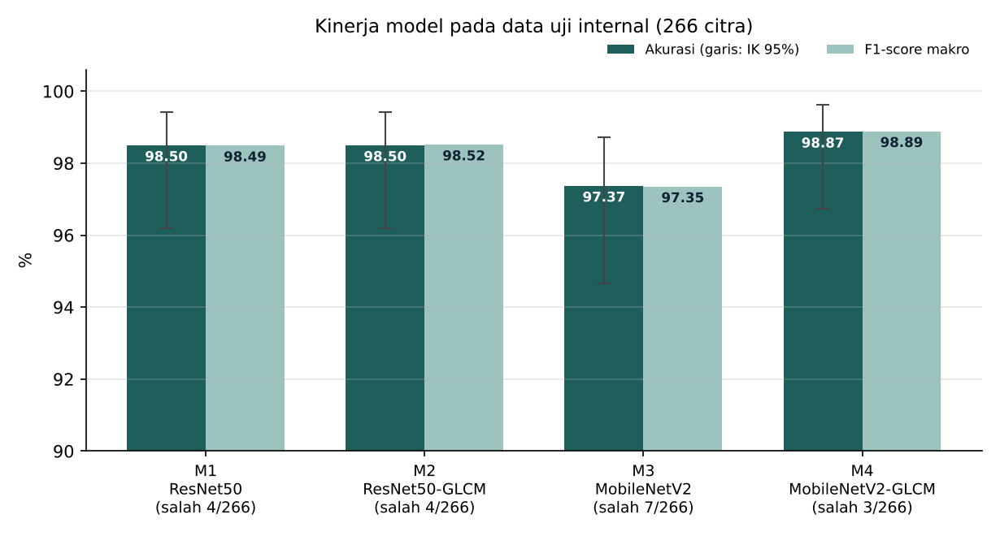
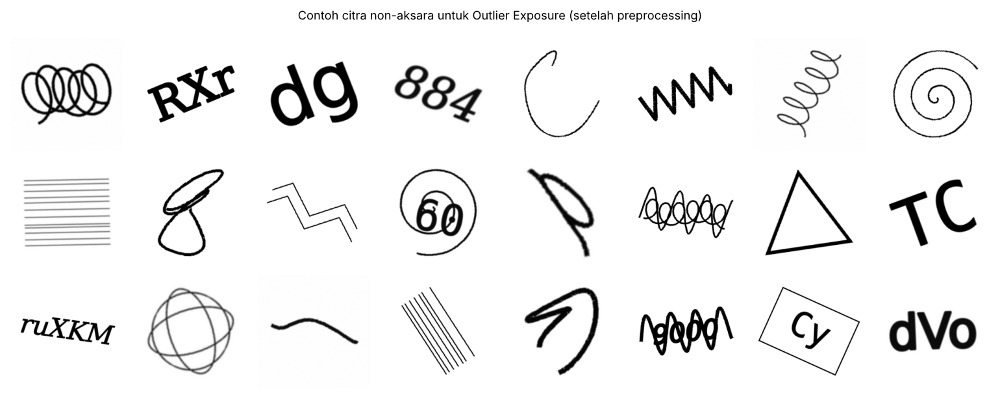
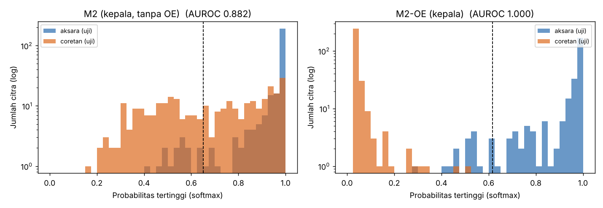

# Klasifikasi Tulisan Tangan Aksara Sunda dengan Model Hibrida ResNet50 dan GLCM

Proyek Machine Learning (Project-Based Learning), Semester 5, Program Studi Informatika, Universitas Pignatelli Triputra.

**Dosen pengampu:** Tutus Praningki, S.Kom., M.Kom.

**Anggota tim:**

- Christian Petra Kurniawan (243016015), ketua
- Satria Putra Kurniawan (243016016)
- Afif Mauriz Subianto (243016017)
- Wisnu Kertopati (243016018)

## Tentang proyek

Proyek ini mengklasifikasikan 30 karakter dasar Aksara Sunda (7 aksara swara dan 23 aksara ngalagena) dari citra tulisan tangan.

Pertanyaan utamanya: apakah penambahan 32 fitur tekstur GLCM (Gray-Level Co-occurrence Matrix) pada ResNet50 meningkatkan kinerja dibandingkan ResNet50 saja? MobileNetV2 digunakan sebagai arsitektur pembanding.

Empat model yang dibandingkan:

| Kode | Model | Peran |
|------|-------|-------|
| M1 | ResNet50 | Baseline utama |
| M2 | ResNet50 + GLCM | Model usulan |
| M3 | MobileNetV2 | Baseline pembanding |
| M4 | MobileNetV2 + GLCM | Pembanding pengaruh GLCM |

## Pipeline

Panduan lengkap langkah demi langkah, dari dataset sampai aplikasi: [docs/PANDUAN_DARI_AWAL_SAMPAI_APP.md](docs/PANDUAN_DARI_AWAL_SAMPAI_APP.md)


**1. EDA dan pembersihan awal** (`EDA.py`)

- Membaca seluruh citra dan mengambil label dari nama folder.
- Memeriksa berkas korup (tidak ditemukan) dan menghapus 1 duplikat identik.
- Menandai 26 citra pencilan kecerahan/ketajaman (tetap dipakai).
- Membagi data secara berstrata (kelas dan sumber citra) menjadi 70% latih, 15% validasi, 15% uji.

**2. Pembersihan lanjutan dan preprocessing** (`run_preprocessing.py`)

- Grayscale, pemotongan area karakter (Otsu), padding persegi, resize 224 x 224.
- Membuang 23 citra hampir-duplikat agar tidak ada citra yang sama di data latih dan data uji.
- Mengekstraksi 32 fitur GLCM dan menstandardisasinya dengan scaler yang di-fit pada data latih.

**3. Pelatihan** (`train_model.py`)

- Augmentasi hanya pada data latih: rotasi ±10°, skala 0,90 sampai 1,05, geser ±5%, tanpa flip.
- Tahap 1: backbone dibekukan, learning rate 1e-3.
- Tahap 2: fine-tuning 30 lapisan terakhir, learning rate 1e-5, early stopping.

**4. Evaluasi** (`evaluasi.py`)

- Akurasi dengan interval kepercayaan 95%, precision, recall, F1-score makro.
- Uji McNemar, F1 per kelas, dan analisis kesalahan.

**5. Penanganan coretan non-aksara** (`buat_outlier.py`, `train_oe.py`)

- M1 sampai M4 hanya mengenal 30 kelas, sehingga coretan yang bukan aksara tetap dipaksa masuk ke salah satu kelas, sering dengan persentase tinggi.
- M2 dilatih lanjut dengan *Outlier Exposure* (Hendrycks dkk., 2019) menjadi **M2-OE**: coretan non-aksara diberi target persentase merata (1/30 per kelas), sehingga model belajar memberi persentase rendah untuk masukan yang bukan aksara. Tidak ada kelas "bukan aksara" tambahan.
- Hasil M1 sampai M4 di laporan tidak berubah.

**6. Aplikasi web** (folder `app`)

- Backend FastAPI dan frontend HTML/JavaScript memakai M2-OE (atau M2 bila M2-OE belum dilatih).
- Jika persentase tertinggi di bawah ambang, aplikasi menampilkan "Tidak dikenali".

## Data

| Keterangan | Jumlah |
|------------|--------|
| Citra mentah | 1.800 (30 kelas x 60 citra) |
| Sumber | 600 foto kamera, 1.200 citra sumber lain |
| Duplikat identik dibuang | 1 |
| Hampir-duplikat dibuang | 23 |
| Data latih | 1.244 |
| Data validasi | 266 |
| Data uji | 266 |

Dataset disertakan di folder `dataset_gabung_fix` (30 subfolder kelas). Folder ini sudah tanpa satu citra duplikat, sehingga berisi 1.799 citra; angka 1.800 di tabel adalah jumlah sebelum duplikat dibuang. Sumber: [Aksara Sunda di Kaggle](https://www.kaggle.com/datasets/abdidwiramdani/aksara-sunda) (Abdi Dwi Ramdani).

## Hasil

Hasil pelatihan final (run ke-3) pada data uji internal (266 citra):

| Model | Validasi akurasi | Uji akurasi | Interval kepercayaan 95% | Uji macro-F1 | Salah |
|-------|------------------|-------------|--------------------------|--------------|-------|
| M1 ResNet50 | 97,74% | 98,50% | 96,2% – 99,4% | 98,49% | 4 |
| **M2 ResNet50 + GLCM** | **98,50%** | 98,50% | 96,2% – 99,4% | 98,52% | 4 |
| M3 MobileNetV2 | 95,11% | 97,37% | 94,7% – 98,7% | 97,35% | 7 |
| M4 MobileNetV2 + GLCM | 96,62% | 98,87% | 96,7% – 99,6% | 98,89% | 3 |



Karena hasil pelatihan di GPU sedikit berbeda setiap kali diulang, keempat model dilatih tiga kali dengan pengaturan yang sama:

| Model | Run 1 | Run 2 | Run 3 (final) | Rata-rata ± SD |
|-------|-------|-------|---------------|----------------|
| M1 ResNet50 | 98,50% | 98,50% | 98,50% | 98,50 ± 0,00% |
| M2 ResNet50 + GLCM | 99,25% | 99,62% | 98,50% | 99,12 ± 0,57% |
| M3 MobileNetV2 | 96,24% | 96,24% | 97,37% | 96,62 ± 0,65% |
| M4 MobileNetV2 + GLCM | 97,74% | 97,74% | 98,87% | 98,12 ± 0,65% |

Temuan utama:

- M2 (ResNet50 + GLCM) memiliki kinerja validasi terbaik (validation loss 0,0666, akurasi validasi 98,50%), sehingga dipilih sebagai model final dan dipakai di aplikasi.
- Rata-rata dari tiga kali pelatihan, penambahan GLCM menaikkan akurasi sekitar 0,6 poin pada ResNet50 dan 1,5 poin pada MobileNetV2.
- Selisih antar-model hanya beberapa citra dan belum signifikan secara statistik (uji McNemar). Variasi antar-run sama besarnya dengan selisih antar-model.
- Kesalahan yang paling sering muncul adalah pertukaran aksara *a*, *ae*, dan *eu*, yang memiliki bentuk dasar sama.
- Data uji berasal dari pembagian acak dataset publik, sehingga akurasi pada tulisan orang baru kemungkinan lebih rendah.

Rincian lengkap ada di folder `evaluasi_output/` dan `hasil_M1/` sampai `hasil_M4/`.

### Coretan non-aksara (Outlier Exposure)

Data: 2.100 citra non-aksara buatan (coretan, ikal, spiral, bentuk geometris, gelombang, arsiran, huruf dan angka Latin) di folder `outlier/`, dibagi 1.500 latih, 300 validasi, 300 uji. Citra yang terlalu mirip aksara asli dibuang otomatis.



Uji konsep (bagian klasifikasi saja di atas fitur ResNet50 ImageNet yang dibekukan, dijalankan di CPU) menunjukkan efeknya:

| Ukuran | Tanpa OE | Dengan OE |
|--------|----------|-----------|
| Akurasi aksara uji | 96,2% | 96,6% |
| Rata-rata persentase tertinggi pada coretan uji | 68,5% | 5,2% |
| Coretan uji dengan persentase ≥ 90% | 26,3% | 0% |
| Coretan uji yang ditolak (di bawah ambang) | 44,0% | 100% |
| Jenis gambar yang tidak pernah dilatih (huruf Yunani/Kiril, simbol), ditolak | 32,0% | 94,0% |



Ambang ditentukan dari data validasi aksara (persentil ke-5), sehingga sekitar 95% aksara asli tetap diterima. Angka untuk M2-OE penuh (dengan fine-tuning) dihasilkan oleh `train_oe.py` di `hasil_M2OE/tabel_oe.csv`.

## Cara menjalankan

### 1. Instal library

Gunakan Python 3.10 sampai 3.12.

```bash
pip install -r requirements.txt
```

### 2. Dataset

Dataset sudah tersedia di folder `dataset_gabung_fix`, jadi tidak perlu diunduh terpisah.

### 3. Jalankan pipeline

```bash
python run_preprocessing.py
python train_model.py --model M1
python train_model.py --model M2
python train_model.py --model M3
python train_model.py --model M4
python evaluasi.py
python train_oe.py        # M2-OE, butuh hasil_M2/best.keras
```

Catatan:

- Folder `eda_output` berisi pembagian data asli yang dipakai di laporan, jadi `EDA.py` tidak perlu dijalankan ulang. Menjalankannya ulang di folder proyek akan membuat pembagian data baru (dengan 1.799 citra) sehingga hasil tidak lagi sama dengan laporan.
- Folder `preprocessing_output` sudah berisi hasil preprocessing (pembagian data akhir, scaler GLCM, daftar kelas). `run_preprocessing.py` tetap perlu dijalankan sekali sebelum pelatihan untuk membuat cache citra `preprocessed_224.npz` (sekitar 1 menit).

### 4. Alternatif: Google Colab (disarankan, memakai GPU)

Notebook ada di folder `notebooks`:

- `Pelatihan_M1_M2.ipynb` untuk preprocessing serta pelatihan M1 dan M2.
- `Lanjutan_M3_M4_Evaluasi.ipynb` untuk pelatihan M3, M4, dan evaluasi semua model.
- `Outlier_Exposure_M2OE.ipynb` untuk melatih M2-OE (setelah M2 selesai).

Upload zip repositori ini (`aksara-sunda-resnet50-glcm.zip`) ke My Drive tanpa diekstrak, buka notebook di Colab, pilih GPU T4, lalu jalankan *Runtime > Run all*. Notebook akan mengekstrak zip secara otomatis.

### 5. Jalankan aplikasi web

File yang dibutuhkan:

- `hasil_M2OE/best.keras` dan `hasil_M2OE/ambang_ood.json` (hasil `train_oe.py`), atau `hasil_M2/best.keras` bila M2-OE belum dilatih (tanpa deteksi "Tidak dikenali")
- `preprocessing_output/scaler_glcm.joblib` (sudah tersedia)
- `preprocessing_output/class_names.json` (sudah tersedia)

```bash
python app/main.py
```

Buka `http://localhost:8000` di browser.

## Model terlatih

File model `best.keras` tidak disimpan di repositori karena ukurannya melebihi batas GitHub (100 MB per file). Model dapat dilatih ulang dengan langkah di atas, sekitar 10 menit per model di GPU Google Colab.

## Isi repositori

| File / folder | Fungsi |
|---------------|--------|
| `EDA.py` | Eksplorasi data, pembersihan awal, pembagian data |
| `run_preprocessing.py` | Pembersihan lanjutan, preprocessing, ekstraksi GLCM |
| `train_model.py` | Pelatihan model M1 sampai M4 |
| `evaluasi.py` | Evaluasi dan perbandingan model |
| `buat_outlier.py` | Membuat citra coretan non-aksara untuk Outlier Exposure |
| `train_oe.py` | Pelatihan M2-OE dan perbandingannya dengan M2 |
| `uji_eksternal.py` | Uji model pada tulisan tangan penulis baru (folder `uji_eksternal/`) |
| `config.py` | Semua parameter (ukuran citra, GLCM, augmentasi) |
| `preprocessing.py` | Fungsi crop, padding, resize, normalisasi |
| `augmentation.py` | Augmentasi data latih |
| `glcm_features.py` | Ekstraksi 32 fitur GLCM |
| `data_loader.py` | Penyedia batch data untuk Keras |
| `app/` | Aplikasi web (FastAPI + HTML/JavaScript) |
| `dataset_gabung_fix/` | Dataset citra (30 subfolder kelas) |
| `eda_output/` | Hasil EDA dan pembagian data |
| `preprocessing_output/` | Hasil preprocessing, scaler GLCM, daftar kelas |
| `outlier/` | 2.100 citra coretan non-aksara (latih, validasi, uji) |
| `hasil_M1/` s.d. `hasil_M4/` | Ringkasan hasil, riwayat pelatihan, confusion matrix tiap model |
| `evaluasi_output/` | Tabel perbandingan, uji McNemar, F1 per kelas, gambar evaluasi |
| `notebooks/` | Notebook Google Colab |
| `docs/` | Panduan lengkap dan gambar laporan |
| `requirements.txt` | Daftar library Python |

## Teknologi

Python, TensorFlow/Keras, scikit-learn, scikit-image, OpenCV, FastAPI, HTML/CSS/JavaScript, Google Colab.
