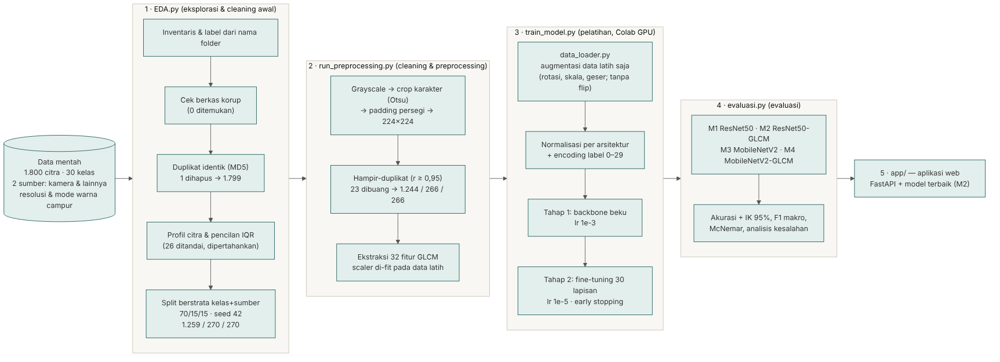

# Panduan: dari dataset sampai aplikasi

Panduan ini menjelaskan seluruh alur proyek secara berurutan: apa yang dilakukan di setiap tahap, kenapa, file apa yang dijalankan, dan hasilnya.



Ringkasan alur:

| Tahap | File | Masukan | Keluaran | Bisa dijalankan di |
|-------|------|---------|----------|---------------------|
| 0. Dataset | – | – | `dataset_gabung_fix/` | (sudah tersedia) |
| 1. EDA | `EDA.py` | dataset | `eda_output/` | Laptop / Colab |
| 2. Preprocessing | `run_preprocessing.py` | dataset + `eda_output/` | `preprocessing_output/` | Laptop / Colab |
| 3. Pelatihan | `train_model.py` | `preprocessing_output/` | `hasil_M1/` s.d. `hasil_M4/` | **Colab (GPU)** |
| 4. Evaluasi | `evaluasi.py` | `hasil_Mx/` | `evaluasi_output/` | Colab / Laptop |
| 5. Coretan non-aksara | `buat_outlier.py`, `train_oe.py` | `hasil_M2/` + dataset | `outlier/`, `hasil_M2OE/` | **Colab (GPU)** |
| 6. Aplikasi | `app/main.py` | `hasil_M2OE/` (atau `hasil_M2/`) + `preprocessing_output/` | website lokal | Laptop |

Setiap tahap memakai hasil tahap sebelumnya, jadi urutannya tidak boleh dilompati.

---

## Tahap 0: Dataset

Folder `dataset_gabung_fix/` berisi 30 subfolder, satu per aksara (`a`, `ae`, `ba`, ... `za`). Nama subfolder adalah label kelasnya.

Dataset ini gabungan dua sumber: foto kamera (nama berkas `IMG_...`) dan citra dari sumber lain. Versi di repositori sudah tanpa satu citra duplikat, sehingga berisi **1.799 citra** (laporan menyebut 1.800 citra mentah sebelum duplikat dibuang).

---

## Tahap 1: EDA dan pembersihan awal (`EDA.py`)

**Tujuan:** mengenali data sebelum dipakai, menemukan masalah, dan membagi data.

Yang dilakukan:

1. Membaca semua citra dan mencatat ukuran, mode warna, kecerahan, kontras, ketajaman, dan hash MD5.
2. Mencari berkas korup dan citra duplikat identik.
3. Menandai citra pencilan (terlalu gelap/terang/buram) dengan metode IQR.
4. Membuat grafik distribusi kelas, properti citra, contoh citra, rata-rata citra, dan kecerahan per kelas.
5. Membagi data 70% latih, 15% validasi, 15% uji secara berstrata (proporsi kelas dan sumber citra sama di setiap bagian).

Keluaran di `eda_output/`:

| File | Isi |
|------|-----|
| `01` s.d. `05_*.png` | Grafik EDA untuk laporan |
| `ringkasan_eda.txt` | Ringkasan angka |
| `metadata_raw.csv` | Data setiap citra mentah |
| `gambar_outlier.csv` | Daftar citra pencilan |
| `dataset_bersih.csv` | Daftar citra setelah pembersihan awal |
| `split_train.csv`, `split_val.csv`, `split_test.csv` | **Pembagian data, dipakai tahap berikutnya** |

> **Penting:** `eda_output/` di repositori adalah hasil asli yang dipakai di laporan. Jangan jalankan ulang `EDA.py` di folder proyek utama, karena pembagian datanya akan berubah dan hasil pelatihan tidak bisa dibandingkan lagi. Kalau ingin mencoba, salin dulu proyeknya ke folder lain.

---

## Tahap 2: Pembersihan lanjutan dan preprocessing (`run_preprocessing.py`)

**Tujuan:** menyeragamkan citra agar siap dipakai model, dan memastikan tidak ada kebocoran data.

```bash
python run_preprocessing.py
```

Yang dilakukan pada setiap citra:

1. Diubah ke grayscale.
2. Area karakter dipotong (ambang Otsu) dengan margin 15%.
3. Diberi padding hingga persegi agar bentuk aksara tidak tertarik/gepeng.
4. Diubah ukurannya menjadi 224 x 224 piksel (ukuran input ResNet50 dan MobileNetV2).

Lalu:

5. Citra hampir-duplikat (korelasi piksel ≥ 0,95) dicari. Ditemukan 23 pasangan, 7 di antaranya terpisah antara data latih dan data uji. Satu citra dari tiap pasangan dibuang.
6. 32 fitur tekstur GLCM dihitung untuk setiap citra, lalu dibuat scaler (standardisasi) **hanya dari data latih**.

Hasil akhir: 1.244 citra latih, 266 validasi, 266 uji.

Keluaran di `preprocessing_output/`:

| File | Isi |
|------|-----|
| `preprocessed_224.npz` | Cache semua citra 224 x 224 (dibuat saat skrip dijalankan, tidak ada di repositori) |
| `split_*.csv` | **Pembagian data final** |
| `scaler_glcm.joblib` | Scaler fitur GLCM (dipakai saat pelatihan dan di aplikasi) |
| `class_names.json` | Urutan 30 kelas (label 0 sampai 29) |
| `06`, `07`, `08_*.png` | Contoh preprocessing, augmentasi, dan duplikat |
| `ringkasan_preprocessing.txt` | Ringkasan angka |

---

## Tahap 3: Pelatihan (`train_model.py`)

**Tujuan:** melatih empat model dengan pengaturan yang sama supaya perbandingannya adil.

| Kode | Model | Peran |
|------|-------|-------|
| M1 | ResNet50 | Baseline utama |
| M2 | ResNet50 + GLCM | Model usulan |
| M3 | MobileNetV2 | Baseline pembanding |
| M4 | MobileNetV2 + GLCM | Pembanding pengaruh GLCM |

Cara kerja model hibrida (M2 dan M4): citra masuk ke CNN dan menghasilkan vektor fitur visual, lalu digabung dengan 32 fitur GLCM sebelum lapisan klasifikasi (Dense 256, Dropout 0,5, Softmax 30 kelas).

Proses pelatihan:

1. Augmentasi acak pada data latih saja: rotasi ±10°, skala 0,90 sampai 1,05, geser ±5%. Tanpa flip karena mencerminkan aksara mengubah bentuknya.
2. **Tahap 1:** bobot ImageNet dibekukan, hanya lapisan klasifikasi yang dilatih (learning rate 0,001).
3. **Tahap 2:** 30 lapisan terakhir ikut dilatih (fine-tuning, learning rate 0,00001).
4. Early stopping: berhenti jika validation loss tidak membaik selama 5 epoch. Bobot terbaik disimpan.

### Cara menjalankan (disarankan: Google Colab)

Pelatihan butuh GPU. Di laptop tanpa GPU bisa memakan waktu berjam-jam per model.

1. Upload `aksara-sunda-resnet50-glcm.zip` (zip repositori ini) ke **My Drive**. Tidak perlu diekstrak.
2. Upload `notebooks/Pelatihan_M1_M2.ipynb` ke My Drive, klik kanan, pilih **Open with > Google Colaboratory**.
3. **Runtime > Change runtime type > T4 GPU > Save**.
4. **Runtime > Run all**, lalu izinkan akses Google Drive.
5. Tunggu sampai tabel perbandingan M1 vs M2 muncul di bawah (sekitar 20 sampai 30 menit).
6. Untuk M3, M4, dan evaluasi: buka `notebooks/Lanjutan_M3_M4_Evaluasi.ipynb` dengan cara yang sama, lalu Run all.

Semua hasil tersimpan di `My Drive/aksara-sunda-resnet50-glcm/`.

### Cara menjalankan di laptop (opsional)

```bash
python train_model.py --model M1 --smoke    # uji cepat 1 sampai 2 menit, memastikan tidak ada error
python train_model.py --model M1
python train_model.py --model M2
```

Keluaran setiap model di `hasil_Mx/`:

| File | Isi |
|------|-----|
| `best.keras` | Model terbaik |
| `ringkasan_hasil.json` | Akurasi, F1, epoch terbaik, waktu latih |
| `kurva_pelatihan.png` | Grafik loss dan akurasi per epoch |
| `confusion_matrix.png` | Confusion matrix data uji |
| `classification_report.txt` | Precision, recall, F1 per kelas |
| `history.csv` | Catatan pelatihan per epoch |

---

## Tahap 4: Evaluasi (`evaluasi.py`)

**Tujuan:** membandingkan model secara adil pada data uji yang sama.

```bash
python evaluasi.py
```

Yang dihitung: akurasi dengan interval kepercayaan 95%, precision/recall/F1 makro, uji McNemar (apakah selisih antar-model bermakna), F1 per kelas, dan galeri citra yang salah ditebak.

Keluaran di `evaluasi_output/`. Hasil final tim (run ke-3):

| Model | Validasi akurasi | Uji akurasi | Uji macro-F1 | Salah dari 266 |
|-------|------------------|-------------|--------------|----------------|
| M1 ResNet50 | 97,74% | 98,50% | 98,49% | 4 |
| **M2 ResNet50 + GLCM** | **98,50%** | 98,50% | 98,52% | 4 |
| M3 MobileNetV2 | 95,11% | 97,37% | 97,35% | 7 |
| M4 MobileNetV2 + GLCM | 96,62% | 98,87% | 98,89% | 3 |

Model final dipilih berdasarkan **data validasi** (bukan data uji): M2 memiliki validation loss terendah dan akurasi validasi tertinggi, sehingga dipakai di aplikasi. Hasil pelatihan di GPU sedikit berubah setiap kali diulang; rata-rata tiga kali pelatihan ada di README.

> Jangan menjalankan ulang pelatihan setelah angka laporan ditetapkan, karena hasilnya akan sedikit berubah dan file `best.keras` di Drive akan tertimpa.

-------|---------|----------|----------------|
| M1 ResNet50 | 98,50% | 98,49% | 4 |
| **M2 ResNet50 + GLCM** | **99,25%** | **99,26%** | **2** |
| M3 MobileNetV2 | 96,24% | 96,17% | 10 |
| M4 MobileNetV2 + GLCM | 97,74% | 97,72% | 6 |

M2 terbaik, sehingga dipakai di aplikasi. Selisih antar-model belum signifikan secara statistik karena data uji kecil.

---

## Tahap 5: Menangani coretan non-aksara (`buat_outlier.py`, `train_oe.py`)

**Masalah:** M1 sampai M4 hanya mengenal 30 kelas (*closed-set*). Softmax selalu membagi 100% ke 30 kelas itu, jadi coretan sembarang tetap dipaksa menjadi salah satu aksara, sering dengan persentase tinggi (misalnya coretan berikal terbaca *ca* 100%). Ini disebut *overconfidence*.

**Solusi: Outlier Exposure** (Hendrycks dkk., 2019). Model M2 dilatih lanjut dengan contoh coretan non-aksara:

| Jenis citra | Target pelatihan | Artinya |
|-------------|------------------|---------|
| Aksara | 100% pada kelas yang benar | sama seperti sebelumnya |
| Coretan non-aksara | 1/30 (sekitar 3,3%) untuk setiap kelas | "tidak yakin ke kelas mana pun" |

Loss = cross-entropy aksara + 0,5 × cross-entropy coretan terhadap target merata. Softmax dan 30 kelas tetap sama; tidak ada kelas "bukan aksara".

Langkah:

1. `python buat_outlier.py` membuat 2.100 citra non-aksara (coretan, ikal, spiral, bentuk, gelombang, arsiran, huruf dan angka Latin) di `outlier/`. Citra yang terlalu mirip aksara asli dibuang. Latar dan ketebalan tinta dibuat sama dengan data aksara, agar model tidak belajar jalan pintas seperti "latar abu-abu = bukan aksara". Folder ini sudah ada di repositori.
2. `python train_oe.py` memuat M2, lalu melatihnya lanjut dalam dua tahap (kepala klasifikasi, lalu 30 lapisan akhir ResNet50). Setiap batch berisi 32 aksara dan 32 coretan.
3. Ambang "tidak dikenali" diambil dari data validasi aksara (persentil ke-5 persentase tertinggi), sehingga sekitar 95% aksara asli tetap diterima.

Di Colab: buka `notebooks/Outlier_Exposure_M2OE.ipynb`, lalu *Run all*.

Hasil di `hasil_M2OE/`:

| File | Isi |
|------|-----|
| `best.keras` | Model M2-OE |
| `ambang_ood.json` | Ambang yang dipakai aplikasi |
| `tabel_oe.csv` | Perbandingan M2 dan M2-OE: akurasi aksara, coretan ditolak, AUROC |
| `grafik_oe.png` | Sebaran persentase tertinggi untuk aksara dan coretan |
| `contoh_coretan_oe.png` | Contoh prediksi M2-OE pada coretan uji |

---

## Tahap 6: Aplikasi web (`app/`)

**Tujuan:** memakai model yang sudah dilatih untuk menebak aksara dari tulisan pengguna.

Aplikasi **tidak membutuhkan dataset**, hanya hasil pelatihan:

```
hasil_M2OE/best.keras                    (hasil Tahap 5, unduh dari Google Drive)
hasil_M2OE/ambang_ood.json               (hasil Tahap 5)
preprocessing_output/scaler_glcm.joblib  (sudah ada di repositori)
preprocessing_output/class_names.json    (sudah ada di repositori)
```

Cara menjalankan di laptop:

```bash
pip install -r requirements.txt
python app/main.py
```

Bila folder `hasil_M2OE/` ada, aplikasi otomatis memakai M2-OE; bila tidak, memakai M2 (tanpa deteksi "Tidak dikenali"). Tunggu sampai muncul `Model M2OE (resnet50, GLCM=True) siap.`, lalu buka `http://localhost:8000`. Tekan Ctrl+C di terminal untuk berhenti.

Cara kerja aplikasi:

1. Pengguna menulis aksara di kanvas atau mengunggah foto, lalu klik **Kenali**.
2. Browser mengirim gambar ke backend (`POST /api/predict`).
3. Backend memproses gambar dengan **fungsi preprocessing yang sama** seperti saat pelatihan (crop, padding, 224 x 224, normalisasi, GLCM).
4. Model menghasilkan probabilitas 30 kelas, lalu lima teratas dikirim kembali.
5. Jika persentase tertinggi di bawah ambang, hasil ditandai "Tidak dikenali".
6. Browser menampilkan aksara, nama baca, tingkat keyakinan, dan lima kandidat teratas.

File penting:

| File | Fungsi |
|------|--------|
| `app/main.py` | Backend FastAPI: memuat model, menerima gambar, mengirim hasil |
| `app/static/index.html` | Tampilan web (kanvas, unggah foto, hasil) |

---

## Masalah yang sering muncul

| Pesan | Penyebab | Solusi |
|-------|----------|--------|
| `No module named 'cv2'` (atau modul lain) | Library belum terinstal | `pip install -r requirements.txt` |
| `hasil_M2\best.keras tidak ditemukan` | Model belum diunduh / belum dilatih | Unduh `best.keras` ke folder `hasil_M2/` |
| `mount failed` di Colab | Izin Google Drive gagal | Runtime > Disconnect and delete runtime, jalankan sel pertama saja, izinkan semua akses |
| `GPU: []` di Colab | GPU belum aktif | Runtime > Change runtime type > T4 GPU |
| Aplikasi langsung berhenti tanpa pesan | Menjalankan versi lama `main.py` | Pakai `python app/main.py` dari repositori ini atau `uvicorn app.main:app --port 8000` |
| TensorFlow gagal diinstal | Versi Python tidak cocok | Gunakan Python 3.10 sampai 3.12 |
